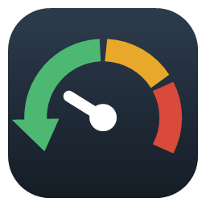

# AgentReclaim

A Windows tray app that watches what AI coding tools (Claude Code, Codex, Gemini CLI) are running, finds what they leave behind, and frees it safely.

Nothing is stopped, throttled or deleted unless you click a button or turn on an automatic rule. Every automatic rule is **off by default**.

## Features

| Area | What it does |
|---|---|
| **Leftovers** | Process trees an agent started and abandoned (the agent or its shell exited, the child kept running). **Stop…** sends Ctrl+C first where that's safe, then force-stops only the processes you approved. |
| **Sessions** | Every running `claude.exe` / `codex.exe` / `gemini.exe` (or npm-installed agent under `node`, such as `@google/gemini-cli`) with its process tree, memory, CPU and listening ports. |
| **Projects** | Sessions, leftovers and their ports grouped by the git repo (or folder) they run in, e.g. "AgentReclaim: 2 sessions, 1.4 GB, port 5173". |
| **Ports** | Every listening TCP port and who holds it: a live session, a leftover, or something else. Find by port, process, PID or project. **Free…** stops the holder and its children (a leftover's whole tree) through the same checks, confirmation and log as **Stop…**; greyed out for system processes, agents and AgentReclaim. |
| **Firewall** | Block ports with Windows Firewall: presets for remote access (SSH, Telnet, FTP, Remote Desktop, VNC, WinRM), file sharing (SMB, NetBIOS), databases (SQL Server, MySQL, PostgreSQL, Redis, MongoDB, Elasticsearch), the Docker API, and **Keep dev servers private** (3000–3010, 4000, 4200, 5000, 5173–5174, 8000, 8080, 8888 and the Node debugger 9229), plus your own ports and ranges. **Nothing is blocked by default.** Each port can block incoming, outgoing or both; its status says whether it's blocked, open (and which program listens on it, on the network or this PC only) or not in use. **Apply…** asks Windows for administrator permission once and adds block rules named `AgentReclaim: block TCP 22 in` in the group "AgentReclaim"; **Remove all AgentReclaim blocks…** takes them out again. Localhost isn't affected. |
| **Findings** | Piles of old idle children under a live agent (e.g. hundreds of `node_repl.exe` under a Codex app-server), agents whose own memory keeps climbing, and processes that may be stuck: a command an agent started that has done nothing for 10 minutes (often a password or yes/no prompt nobody can see), or anything in a session keeping a whole CPU core busy for 15 minutes. Stuck processes are also marked on the Sessions tab with a **Stop…** button (never for an agent itself); an optional notification is off by default, and so is the option to stop them automatically (separately for "no activity" and "busy"; never an agent, nothing using a TCP or UDP port or with an open connection, each only once; ports and connections are read again just before the stop). The agent sees the stopped command fail and can run it again; AgentReclaim never reruns it itself, since that would run it twice, outside the agent. |
| **Cleanup** | WSL/Docker VM memory: shut WSL down, or switch automatic memory reclaim on (`dropCache`, WSL's default) or off (`autoMemoryReclaim=disabled`) in `.wslconfig` (backup kept each time). Disk: old Claude Code / Codex temp folders (to the Recycle Bin), npm/pip/uv caches (via the tool's own clean command), clean stale git worktrees (`git worktree remove`, which refuses if there are changes). |
| **Docker containers** | Cleanup → Docker containers lists running containers with memory, ports and uptime, tied to a project by their compose folder (`com.docker.compose.project.working_dir`). Ones in a folder where an agent is working, has leftovers, or worked today are listed first. **Stop…** runs `docker stop` (10 s to shut down; the container and its data are kept, unless it was started with `--rm`, which the confirmation spells out) after a confirmation, logged like any other stop. Containers aren't stopped automatically. |
| **Auto rules** (opt-in) | Stop leftovers that were *seen* under an agent, have no open connections and have been idle N minutes. Throttle (lower priority + EcoQoS) build/test tools that hog the CPU under an agent. **Cap each agent session's memory** (off by default) puts what an agent starts into a Windows job object with a memory limit (8 GB by default); the agent itself is never capped, so reaching the limit fails a build or server with out-of-memory, not the session, and you're told when a session hits it. |
| **Activity** | Every action (including stops an agent makes through MCP, as they happen), with **Relaunch** to start a stopped process again in its original folder. |
| **Claude Code hook** (opt-in) | A `SessionEnd` hook that tells the app a session ended, so its leftovers only need a short grace period. |
| **MCP server** | Read-only tools (`resource_overview`, `list_session_processes`, `list_leftovers`, `list_my_processes`) so an agent can ask what's using the machine. Opt-in `stop_my_process` (Settings → Integrations, **off by default**) lets the agent that started the server stop processes in its own tree and its own leftovers, nothing else (see Safety model). |
| **Low-memory alert** | When memory stays above 90% (adjustable), one notification naming the biggest AI-related users: leftovers, the WSL/Docker VM, sessions, piles of idle children. Click it to open the app. It doesn't stop anything and won't repeat until memory drops back down (at most every 30 min). On by default; Settings → Notifications. |
| **Leftover notice** (opt-in) | "Claude Code left node.exe running on port 5173 (shop)": one notification when an agent leaves something running. Off by default; Settings → Notifications. |
| **History** | AI-tool memory over the last 24 hours (one point a minute): all tools together and the four projects that used the most, with hover values and the same data as a table. Plus what was freed in the last day, split into you, automatic rules and agents (MCP). Kept in `history.json`. |
| **Appearance** | Light, dark or Auto (follows Windows' app mode, live). Settings → Appearance. |
| **Tray** | Memory gauge (green / amber / red) with an orange dot when there are leftovers. **Free safe leftovers…** stops, after one confirmation listing them, every leftover that passes the auto-stop checks (seen under an agent, idle, no connections), re-checking each on a fresh scan just before it is stopped; start with Windows (opt-in). |
| **Updates** | Checks GitHub Releases daily. Choose *Don't check*, *Tell me* (default) or *Install automatically*. Packages are verified against the SHA-256 published with the release, the exe is swapped and the app restarts in the tray. If the new version doesn't start and report ready within 90 s, the previous exe is put back and restarted, and that version is not auto-installed again. Settings → Updates, or tray → Check for updates. |
| **Debug log** | `%LOCALAPPDATA%\AgentReclaim\logs`, one file per day, 7 days kept, 10 MB/day cap. Info level by default; Settings → Diagnostics → Debug logging adds every poll and decision. **Copy diagnostics** copies versions and settings (no process data) for bug reports. |

## Safety model

- **Attribution.** Each poll (every 3 s) walks every parent chain; a parent only counts if it started before the child (Windows reuses PIDs). Everything under a live agent is recorded in `lineage.json`, including descendants that inherit ownership after their parent exits. An empty or failed process listing raises an error instead of wiping that history.
- **Never listed as leftovers:** agents themselves (including detached daemons), anything hosting a live agent (e.g. a plugin broker), and AgentReclaim.
- **Stopping** re-reads the live tree after you confirm and refuses if it gained processes, or if Windows won't let it stop one of them (a service or elevated process), instead of stopping part of it. It holds identity-checked handles and terminates only the approved instances; there is no recursive kill. Ctrl+C is sent by a separate helper process, and only when every process on that console was approved, so your own terminal is never interrupted.
- **Logging.** An "intent" line is written before acting and a "done" line after; if the intent can't be logged, nothing is stopped.
- **Protected:** IDEs, terminals, WSL/Docker, system processes.
- **Auto-stop** only applies to leftovers with an observed (not guessed) owner, no established connections, and passing the same safety checks. It stops at most one tree per fresh snapshot, re-reads network connections right before stopping, and does nothing if connection data is unavailable. After a hook-reported session end, the grace period counts from the end itself.
- **Free safe leftovers** (tray) uses the auto-stop checks whether or not auto-stop is on, stops one tree per fresh snapshot, and skips anything that no longer passes. Pausing monitoring drops what's still queued.
- **Memory caps** (opt-in) never put an agent (nor a `node.exe` whose command line can't be read yet), a console host or anything the safety policy protects (IDEs, terminals, system processes) in the job, and check each process's start time before adding it. Nothing joins a job by inheritance (silent breakaway): every eligible process under the session is added explicitly within a poll, so an agent or IDE launched from a capped shell is never capped. A process that can't join (e.g. it is already in another job that can't be combined) is reported once and retried every minute. Turning the setting off lifts the caps from every job AgentReclaim still holds, at once (also while monitoring is paused, and again on exit) (it keeps a job while its agent, anything in it, or any of its leftovers runs, and keeps adding what those leftovers start). Windows can't take a process out of a job, so processes capped before AgentReclaim restarted keep their cap until they exit.
- **Docker** stops only by full container id, after a confirmation that warns when no agent worked in its folder. It never removes containers, images or volumes itself; a container started with `--rm` is marked, and its confirmation says plainly that Docker will delete it and its anonymous volumes when it stops.
- **Firewall** rules are only ever *block* rules in AgentReclaim's own group: it never creates an allow rule and never changes or removes a rule it didn't create (one with the same name but another group is left alone and reported). The change runs in a separate elevated helper (`AgentReclaim.exe firewall apply …`) that rejects its whole command line if any part of it isn't a valid rule. Before asking, the app re-reads the firewall and the connection tables: it refuses to block the Remote Desktop port from a Remote Desktop session, and warns when a port has live connections (an SSH session, say). Rules it removes or restores are judged by what they are now: one changed outside AgentReclaim into an allow rule is flagged, and refused if it might be what lets your Remote Desktop session in. Only one firewall change runs at a time (a machine-wide lock covers the helper's whole read-and-change), and the helper is told exactly which rules you approved removing or replacing, as fingerprints of every copy and setting: one added or changed since you looked (from another session, say) stays. It repeats the Remote Desktop checks itself with its own readings, so the uninstaller's cleanup is covered too. A changed rule is never edited: a correct block goes in first under a temporary name, then the changed rule is removed and the new one takes its name, so a failure at any step leaves the port (and anything else the changed rule covered) blocked. Everything is added first and read back before anything is removed, and each removal (one copy at a time) re-reads the whole firewall at that moment: it stops if a wanted block is no longer in place, and skips the rule if it changed meanwhile (other programs can change the firewall too) or if any of its settings can't be read. The confirmation lists what each removed rule really covers now, not what its name says. Afterwards it reads the firewall back and reports what's really in place, rather than trusting the helper. Every wanted block is put in place before anything is unblocked, and nothing is unblocked if that failed or if some firewall rule couldn't be read. Rules changed outside AgentReclaim (disabled, turned into allow, narrowed to a network card, app or user) are shown, with what they do now, and replaced on the next apply. Agents can't change the firewall (there's no MCP tool for it). Block rules only work while Windows Firewall is on for your network; the tab says when it's off, managed by Group Policy, when another firewall is installed, or when IPsec authenticated-bypass allow rules exist (Windows lets those override blocks for the users or machines they list). Rule names are compared ignoring case, as Windows does, so a same-named rule in different capitals is never removed. WSL's mirrored networking and Docker's internal networks can have firewalls of their own.
- **Worktree cleanup** only offers worktrees with no changes and no ignored files except build output (`node_modules`, `bin`, `obj`, …), checks again right before removal, and says that removal is permanent.
- **Agents stopping their own processes** (MCP, opt-in): the caller is the nearest agent above the MCP server, found by walking parents that started before their child (so a reused PID can't pose as the agent). It may only stop processes under itself and leftovers recorded as its own (also when it was started by another agent), never itself, the MCP server or anything between them (nor what hangs off those, like their console host), never another agent (nor a `node.exe` whose command line can't be read, since it could be one) or a protected process. Stops name an exact process instance (pid plus start time) from `list_my_processes`, so a reused pid never matches. The same re-checks and intent/done log as manual stops apply, with the trigger `mcp: <agent> (pid N)`. Your MCP client still asks before each call unless you allowed the tool. This is a guardrail against an agent stopping the wrong thing by mistake, not a security boundary: a program running as you can fake its parent process, but it could also stop those processes directly.
- **Relaunch** only runs in the original folder; if it's gone, it refuses rather than guess.
- **Updates** only replace AgentReclaim's own single-file exe, and are checksum-verified. The checksum comes from the same GitHub release, so it catches corrupt downloads, not a compromised account; sign releases for that.

## Build & run

Requires the .NET 9 SDK.

```
dotnet build
dotnet test
dotnet run --project src/AgentReclaim.App          # opens the window
dotnet run --project src/AgentReclaim.App -- --tray # starts hidden in the tray
```

Closing the window keeps it in the tray; use the tray menu → Exit.

## Install

Two downloads on each [release](https://github.com/baslawson/AgentReclaim/releases), both self-contained (no .NET needed):

- **`AgentReclaim-<version>-win-x64-setup.exe`**: installs for your user only (no admin) to `%LOCALAPPDATA%\Programs\AgentReclaim`, with a Start menu entry, optional desktop shortcut and start-with-Windows, and an uninstaller in Settings → Apps. Uninstalling stops the app, removes start-with-Windows and the Claude Code hook only if they point at the installed copy, asks before removing AgentReclaim's firewall blocks (with an administrator prompt) and before deleting your settings and history. With the portable zip, remove the blocks in the app first (Firewall → Remove all AgentReclaim blocks), or in an administrator PowerShell: `Remove-NetFirewallRule -Group "AgentReclaim"`.
- **`AgentReclaim-<version>-win-x64.zip`**: portable. Unzip anywhere and run.

Both update themselves the same way. Neither is code-signed yet, so SmartScreen warns on first run.

### Release build

```
./build/publish.ps1                          # tests, then the single-file exe, zip, setup exe and .sha256 files in dist/
./build/publish.ps1 -CertThumbprint <sha1>   # also signs the exe and setup (needs the Windows SDK's signtool)
```

The setup exe needs Inno Setup 6 (`winget install JRSoftware.InnoSetup`); without it the script builds the zip only. The exe (~71 MB) needs no .NET install. Unsigned builds trigger a SmartScreen warning on other machines. Sign with your own code-signing certificate before distributing.

### Command-line modes

| Command | Used by |
|---|---|
| `AgentReclaim.exe [--tray]` | You / Start with Windows |
| `AgentReclaim.exe mcp` | MCP clients, e.g. `claude mcp add agentreclaim -- "C:\path\AgentReclaim.exe" mcp` |
| `AgentReclaim.exe hook session-end` | Claude Code's SessionEnd hook (install it from Settings) |
| `AgentReclaim.exe send-ctrl-c <pids> <approved>` | Internal helper for graceful stops |
| `AgentReclaim.exe.old update-supervise …` | Internal: rolls back an update that fails to start |
| `AgentReclaim.exe uninstall-cleanup` | Internal: run by the uninstaller |
| `AgentReclaim.exe firewall apply <wanted> [--remove <fingerprints>]`, `firewall remove-all`, `firewall has-rules` | Internal: the elevated helper the Firewall tab (and the uninstaller) starts; rules look like `tcp:22:in` |

## Data

`%LOCALAPPDATA%\AgentReclaim`: `settings.json`, `lineage.json` (attribution memory), `actions.jsonl` (every action with command line and folder), `logs\`.

For testing: `AGENTRECLAIM_DATA_DIR` moves the data folder (and gives that instance its own single-instance lock and pipe, so it can run next to your real copy), and `AGENTRECLAIM_UPDATE_API` points the update check at another URL.

## Layout

| Path | Contents |
|---|---|
| `src/AgentReclaim.Core/Collection` | Process snapshot via Toolhelp + handle queries (no WMI, ~40 ms for ~800 processes), TCP table |
| `src/AgentReclaim.Core/Analysis` | Agent signatures, lineage store, session/orphan analyzer, stale-pile and leak findings, ports and projects |
| `src/AgentReclaim.Core/Actions` | Safety policy, terminator, Ctrl+C helper, throttler, session memory caps, relauncher, action log (and its live tail) |
| `src/AgentReclaim.Core/Rules` | Opt-in auto rules, the low-memory alert and the leftover notice (pure decisions, unit-tested) |
| `src/AgentReclaim.Core/Cleanup` | WSL status/shutdown/.wslconfig, Docker containers, disk cleanup scanner |
| `src/AgentReclaim.Core/Firewall` | Port presets, block-rule model and validation, Windows Firewall status (COM, no admin) and the elevated apply, lock-out and live-connection checks |
| `src/AgentReclaim.Core/Integration` | Hook, notification pipe, hook installer, MCP server and its self-stop scope, autostart, installer cleanup |
| `src/AgentReclaim.Core/Updates`, `Diagnostics` | GitHub release check, verified self-update, debug log |
| `src/AgentReclaim.App` | WPF window, tray icon, background monitor, entry point |
| `tests/AgentReclaim.Core.Tests` | 308 tests: analyzer (Claude Code, Codex and Gemini CLI), stuck processes, safety, auto rules, leaks, config editing, MCP (including the self-stop scope), ports, projects, memory alert, leftover notice, Docker, memory caps, history, firewall rules and lock-out checks, logging, updates, Codex-review regressions, live-machine checks |
| `build/publish.ps1`, `build/installer.iss` | Release build and per-user installer |
| `build/make-icon.ps1` | Draws the app icon (`src/AgentReclaim.App/Assets`) |

## Not done yet

- Codex and Gemini CLI have no session-end hook equivalent wired up (their leftovers are still found by lineage and idle time).
- MSIX packaging / winget submission (both need a signing certificate and a hosted download).
